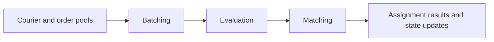

# Delivery Dispatch Algorithm Simulation

This project is a food delivery dispatch simulation framework built with Java and Spring Boot. It provides a foundation for experimenting with order batching, candidate evaluation, and courier–order matching.

The system is still under development. Future work will focus on implementing, testing, and comparing dispatch algorithms through reproducible simulation scenarios, with particular attention to assignment quality, constraint handling, and computational efficiency.

<p>
<strong>THIS FRAMEWORK IS NOT DEVELOPED BY ANY AI MODEL.</strong>
</p>

## Architecture



| Module | Responsibility | Current state |
| :--- | :--- | :--- |
| `dispatch-batching-algorithm` | Build single-order and two-order candidates and apply eligibility checks | Initial implementation; filtering and candidate storage need refinement |
| `dispatch-evaluating-algorithm` | Evaluate candidates through a shared scoring interface | Basic cost, pickup-time and delivery-time scorers; calculations need validation |
| `dispatch-matching-algorithm` | Choose assignments and update courier/order state | Greedy selection with order-conflict and capacity checks; OR-Tools matcher is a placeholder |

## Current scope

- A Maven project with three cooperating modules.
- Spring-managed services for batching, evaluation and matching.
- In-memory courier and order pools.
- A startup demo with four couriers and five orders.
- A scoring interface that can accommodate additional criteria.
- An initial greedy matcher and SLF4J logging in the processing flow.

The current demo runs once through `CommandLineRunner`. There is no HTTP controller or database persistence yet. Starting the application successfully does not establish that the dispatch calculations are correct.

## Run the demo

Requirements: JDK 22, Maven, and access to Maven dependencies.

1. Clone the repository:

   ```bash
   git clone https://github.com/AlanSong2077/dispatch-algorithm.git
   ```

2. Open the root `pom.xml` in IntelliJ IDEA and load the Maven project.
3. Set the project SDK to JDK 22.
4. Run `org.example.Application` in `dispatch-matching-algorithm`.
5. Inspect the console for pool sizes, scoring logs and assignment results.

Demo data is created by the two pool `@Bean` methods in `Application`. Change those fixtures to explore availability, remaining capacity, order readiness and district restrictions. An empty assignment result can indicate filtering or scoring issues; the current implementation can produce non-finite scores.

## Development roadmap

- [ ] Correct and validate geographic distance calculations and measurement units.
- [ ] Refine filtering rules and retain all feasible candidate batches per courier.
- [ ] Define scoring scales, weights and invalid-score handling.
- [ ] Add repeatable tests for capacity, duplicate assignments and empty inputs.
- [ ] Implement global matching with OR-Tools and compare it against the greedy baseline.
- [ ] Improve assignment lifecycle and concurrency handling.
- [ ] Add configurable data loading, persistent records and API endpoints.

The immediate goal is a correct and testable simulation flow. Future development will prioritize repeatable scenarios, algorithm benchmarks and comparisons between matching strategies.

## Feedback

Suggestions and discussions are welcome, especially around dispatch modeling, Java structure and testing. This is a learning project with evolving interfaces and incomplete functionality.
